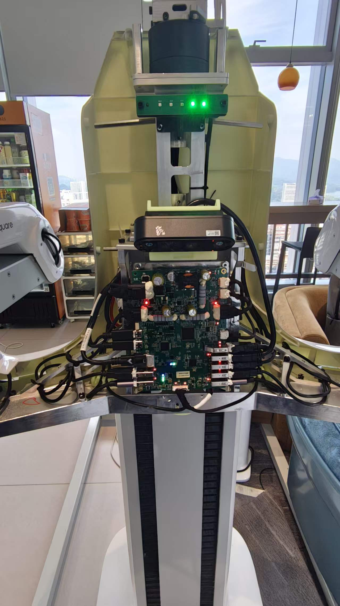

# Humanoid Robot — Software & Hardware Debugging Showcase

具身智能人形机器人软硬件调试工作记录与展示。

## 🤖 项目简介

本仓库记录了本人在 **X Square Robot（X Square Robot / 具身智能公司）** 期间的日常工作内容，围绕轮式双臂人形机器人（WUJI 系列）开展软件与硬件调试：从整机部署、板卡排查，到灵巧手检修，覆盖机器人软硬件全链路。

## 📷 图片展示

### 整机展示 — 轮式双臂人形机器人

### 机器人内部电路调试

整机控制板、传感器与执行器的硬件级排查与调试。

### WUJI 灵巧手拆装与维修

灵巧手精密传动机构、柔性传感器的拆解、检修与复装。

## 🎬 视频演示

点击文件即可在 GitHub 页面内播放：

- [robot-demo-1.mp4](videos/robot-demo-1.mp4) — 机器人运行演示
- [robot-demo-2.mp4](videos/robot-demo-2.mp4) — 机器人功能测试
- [robot-demo-3.mp4](videos/robot-demo-3.mp4) — 现场调试记录

## 💼 工作内容

日常负责机器人**软件 + 硬件的调试与维护**，主要包括：

1. **整机调试与部署**
   - 负责人形机器人在客户现场的安装、上电、标定与功能验收
   - 完成机器人运动控制、感知系统的联调与参数整定

2. **硬件调试与维修**
   - 控制板卡、传感器、执行器等核心部件的故障定位与排查
   - 电源、通信链路（CAN / USB / Ethernet）等底层硬件调试

3. **软件调试**
   - 机器人控制程序、驱动与固件的部署、升级与问题定位
   - 借助日志与调试工具排查运动异常、通信中断等软件问题

4. **灵巧手维护与检修**
   - WUJI 灵巧手的拆解、精密机构检修、传感器标定与复装
   - 手指传动、腱绳驱动与柔性触觉传感的维护

5. **现场支持与产品迭代**
   - 客户现场问题响应与远程技术支持，收集需求并反馈至研发
   - 收集现场运行数据与失效案例，参与产品可靠性改进

## 🛠 技能标签

`具身智能` `人形机器人` `硬件调试` `软件调试` `整机组装` `灵巧手` `现场支持`
