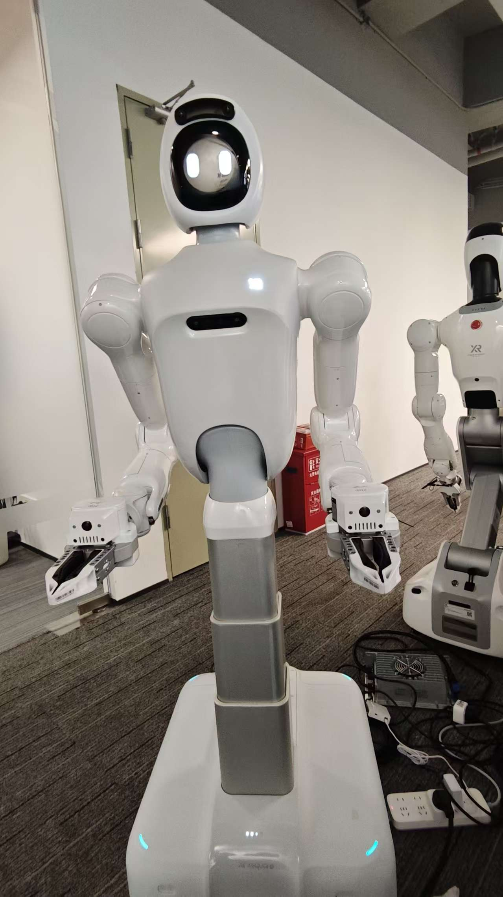
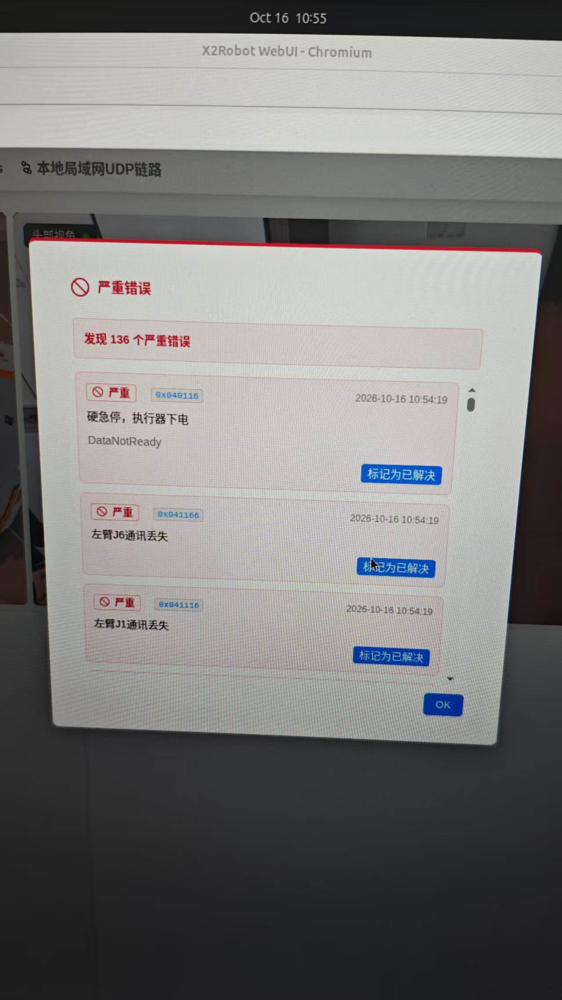
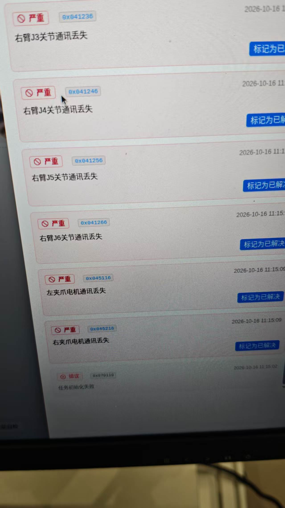
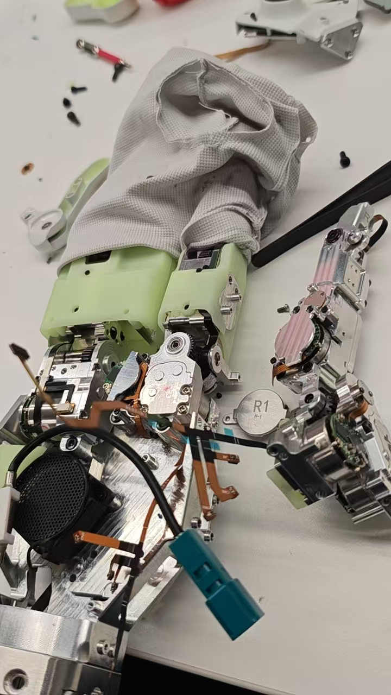
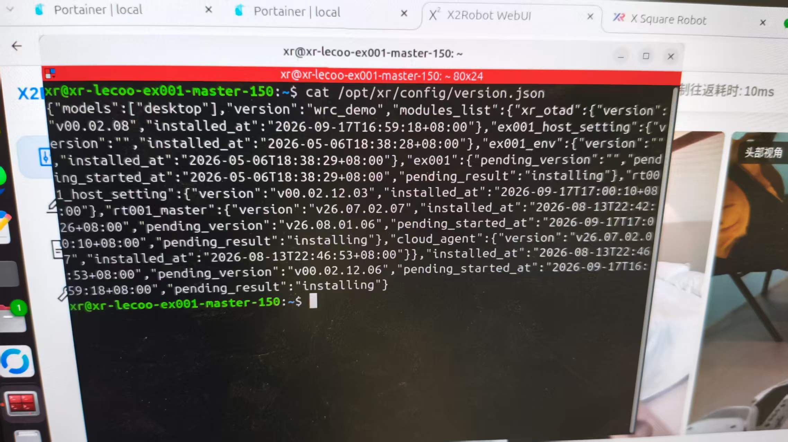

# Humanoid Robot — Software & Hardware Debugging Showcase

具身智能人形机器人**软硬件调试工作展示**（求职作品集）。

- 工作对象：轮式双臂人形机器人（WUJI 系列）
- 工作方向：整机调试 · 硬件维修 · 软件排查 · 灵巧手维护 · 客户现场支持
- 本仓库按「**做了什么 → 遇到什么问题 → 怎么解决**」的结构，整理了 5 个代表性调试案例，全部配有现场图片/视频记录。

---

## 一、代表性案例

### 案例 1：人形机器人整机部署与功能验收

**做了什么**
- 在现场完成轮式双臂人形机器人的组装、上电自检、零位标定与逐项功能验收
- 对底盘移动、双臂运动、夹爪抓取、感知与屏显等模块做整机联调

**遇到的问题**
- 整机初次上电后部分执行器未正常初始化，WebUI 集中报出大量严重错误

**怎么解决**
- 通过 WebUI 错误码逐条定位故障点（见案例 2），并在 Linux 主控终端核对各模块版本与服务状态（见案例 4），故障清零后完成整机验收交付

---

### 案例 2：多关节通讯丢失故障排查（错误码分析）

**做了什么**
- 负责 X2Robot WebUI 错误码的日常监控、解析与闭环处理

**遇到的问题**
- 一次调试中 WebUI 连续报出 **136 个严重错误**，典型错误码包括：
  - `0x04B116`　硬急停、执行器下电（DataNotReady）
  - `0x041116 / 0x041166`　左臂 J1 / J6 关节通讯丢失
  - `0x041236 ~ 0x041266`　右臂 J3–J6 关节通讯丢失
  - `0x045116 / 0x045216`　左 / 右夹爪电机通讯丢失
  - `0x007616`　任务初始化失败

**怎么解决**
1. 按错误码规律归类：多数为「通讯丢失」类，且左右臂、夹爪同时报错，判断为**通讯链路共因问题**而非单点部件损坏
2. 按影响面从大到小排查：急停回路 → 供电状态 → CAN 总线接插件与接线
3. 重新插拔、紧固连接器并逐关节上电复测，故障清除后在 WebUI 中逐条「标记为已解决」
4. 复测双臂与夹爪运动，确认错误不再复报

---

### 案例 3：WUJI 灵巧手故障排查与拆装维修

**做了什么**
- 负责灵巧手的故障排查、拆解检修、传感器标定与复装

**遇到的问题**
- 灵巧手动作异常，需快速判断是软件控制问题，还是机械 / 电气故障

**怎么解决**
- 先在整机上做电气测量与日志确认，缩小问题范围
- 将整手拆下、逐层拆解外壳，依次检查指节传动机构、腱绳 / 连杆、FPC 与连接器、触觉传感器排线
- 修复后复装并做手指动作与传感器读数验证
- 排查全程录像（24 秒）：[wuji-hand-troubleshooting.mp4](videos/wuji-hand-troubleshooting.mp4)

**收获**：熟悉灵巧手内部精密传动结构与柔性传感方案，建立了「整机判断 → 部件级拆检 → 复装验证」的维修流程。

---

### 案例 4：Linux 环境排查与版本管理

**做了什么**
- 在机器人主控（Linux）上通过命令行完成日常排查与版本核对

**常见排查手段**
- `cat /opt/xr/config/version.json` 查看各模块（wrc_demo / ex001 / rt001 / cloud_agent 等）的版本号与升级状态
- 检查服务运行状态与本地局域网 UDP 链路
- 结合日志定位启动异常、通讯中断等软件问题

---

### 案例 5：控制板卡与传感器硬件调试

**做了什么**
- 控制板卡、传感器、执行器等核心部件的故障定位与检修
- 电源回路与 CAN / USB / Ethernet 通信链路的底层硬件调试

---

## 二、视频演示

点击文件即可在 GitHub 页面内播放：

| 视频 | 内容 |
| --- | --- |
| [wuji-hand-troubleshooting.mp4](videos/wuji-hand-troubleshooting.mp4) | WUJI 灵巧手故障排查全程（24s） |
| [robot-demo-1.mp4](videos/robot-demo-1.mp4) | 机器人运行演示 |
| [robot-demo-2.mp4](videos/robot-demo-2.mp4) | 机器人功能测试 |
| [robot-demo-3.mp4](videos/robot-demo-3.mp4) | 现场调试记录 |

## 三、技能清单

| 方向 | 技能 |
| --- | --- |
| 硬件 | 整机装配与标定 · 板卡级故障诊断 · 电源 / 急停回路排查 · CAN / USB / Ethernet 调试 · 传感器标定 |
| 软件 | Linux 命令行排查 · 日志分析 · 错误码解析（X2Robot WebUI）· 固件 / 驱动部署升级 |
| 领域 | 具身智能 · 人形机器人 · 灵巧手维护 · 现场交付与技术支持 |

## 四、技能标签

`具身智能` `人形机器人` `硬件调试` `软件调试` `错误码排查` `Linux` `灵巧手` `现场支持`
